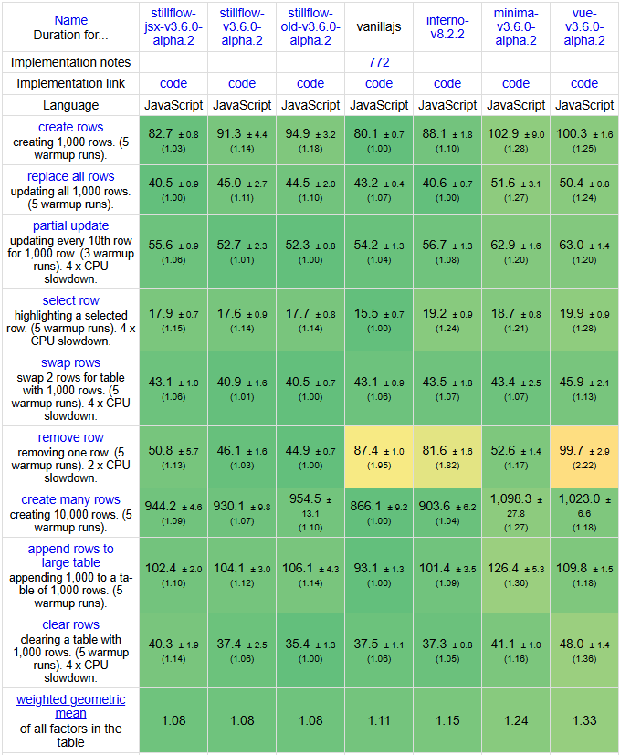

# Stillflow
> A headless, transaction-based UI engine with AOT compilation with predictable performance and memory usage.

## Reasons
I built **Stillflow** to solve my own architectural problems. I wanted explicit control over the life cycle of application with predictable performance with serializable state out of box. My solution does not use **Virtual DOM**, because it's a single most *unpredictable* thing in **UI-heavy applications**, because it does diffing and patch by **O(n)** with a heavy constant. 

## Philosophy

> UI = State + Projections + Bindings + Feedback loop.

I think it is a **misconception** that `UI = f(state)`, because every `UI` has *user and document events* (`click`, `input`, `load` and *etc.*). So I derive that `state = g(UI)`, where `g` **is not** and inverse function of `f`, because we cannot restore *state* from `UI` fully in the most cases, because **UI is a subset of state**. 

Also I think of a `state` as  a `global state` and a simple `"map"` ([Read about it here](http://developer.mozilla.org/en-US/docs/Web/JavaScript/Reference/Global_Objects/Map)) with filled with `primitives` (`number`, `string`, `object` and `array`, but not `symbol`, `function` or `class instances`) as I call it `"map-state"`. You could have thought that it is antipattern and a bad practice so it is out of consideration. But it makes the `state` the **single source of truth** so we can restore `UI` from the *state* fully [`UI = f(state)`]. The *map-state* makes the *serialization* of *state* easier and predictable.

Also I think that **explicit reactivity is better than implicit reactivity**. So **Stillflow** has *`commit()` method that controls the update time. Before *commit* buffer is full, but changes are not applied to the *map-state*. It makes *state-between-state* an impossible occurense. It makes the **Stillflow** model transactional and atomic.

## Features

 1. **AOT-Compilation** --- Compiles JSX into flat object instructions at build time.
 2. **Transactional kernel** --- Explicit `commit()`, multi-buffers `buffer()` and atomic updates.
 3. **Pluggable Collections** --- Built-in Fenwick-based collections for fast clear/remove and Flushable with `flush()` collection for fast `delta` calculations.
 4. **Headless core** --- The core is completely independent of `DOM`
 5. **Type-safe JSX** --- Full autocomplete for `DOM` properties and directives (`sf:`)
 
## Benchmarks

**Stillflow** performs within *1% of VanillaJS* in the Krause benchmark on my notepad in the Krause benchmark, while providing a full transactional state model.


 ## Quick Start

### Let's make some simple Todo application
```ts
import { Stillflow, State, FenwickCollection, FlushableCollection, operators, adapters } from 'stillflow'

type AppState = {
	input: string
}

type TodoItem = {
	label: string
}

type TodoState = {
	input: string,
	items: FlushableCollection<TodoItem>
}

const { jsxdom, DOM } = adapters

const state = new State()
const stillflow = new Stillflow<AppState>(state)
const factory = stillflow.factory()

factory.add(FlushableCollection.name, () => new FlushableCollection(new FenwickCollection(100)))

const source = {
	input: stillflow.variable('input').backref(),
	items: operators.is(FlushableCollection.name)
}

const view = stillflow.compile(source)
const instance: TodoState = stillflow.instantiate(view, factory)

function change(event: any) {
	instance.input = event.target.value
	stillflow.commit()
}

function add() {
	instance.items.add({ label: instance.input })
	instance.input = String()
	stillflow.commit()
}

function TodoItem() {
	return (
		<jsxdom.div>
			{(context: TodoItem) => context.label}
		</jsxdom.div>
	)
}

function App() {
	return (
		<jsxdom.div>
			<jsxdom.input sf:value={(context: TodoState) => context.input} on:change={change}/>
			<jsxdom.button on:click={add}>
				Add
			</jsxdom.button>
			<jsxdom.div sf:for={(context: TodoState) => context.items} sf:each={() => <TodoItem />}/>
		</jsxdom.div>
	)
}

const { element: app, update } = new DOM().$(<App />)

stillflow.on(() => update(instance))

instance.input = String()
stillflow.commit()

document.body.appendChild(app)
```

## How it works

 1. **Compile** --- JSX is parsed into an Intermediate Representation (IR).
 2. **Instantiate** --- State bindings are created.
 3. **Commit** --- Changes are batched and applied to the DOM via highly optimized appliers.
 4. **Collections** -- Delta are calculated and `clear/remove` are logical via Fenwick tree and binary lifting, but `shrink` is physical.

## License

MIT
